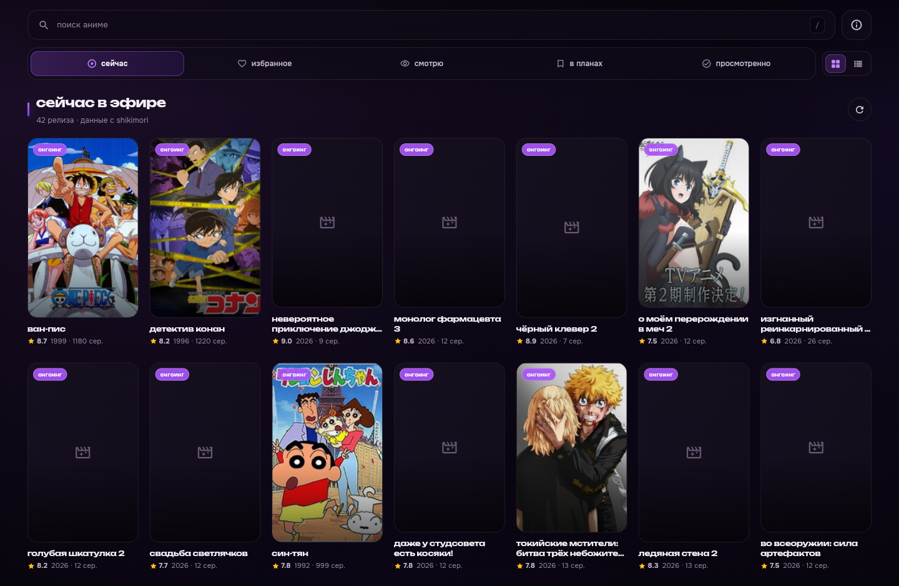

# anishka

**anishka** — a polished, cross-platform anime streaming app built with Flutter.  
No authorization, no in-app ads, black background with purple accent.  
Targets **Windows, Linux, Android, and Web**.

---

## Features

- **Home page**: ongoing anime grid, search field, and library tabs
  (сейчас, избранное, смотрю, в планах, просмотренно).
- **Details page**: synopsis, bookmarks (в планах, смотрю, просмотренно),
  favourite toggle, related releases, and a "воспроизвести" bottom sheet
  with voice/episode picker.
- **Player**: full-screen, HLS via `media_kit`, custom controls,
  seek/volume/speed/quality, episode picker, skip opening/ending,
  progress save, keyboard shortcuts, immersive mobile mode,
  error/loading/completed states.
- **Offline-first caching**: API responses cached in memory + disk
  (`shared_preferences`), library state persists across restarts.
- **All UI lowercase**; **Unbounded** headings, **Onest** body.
- **Free playback**; no ads injected by the app.
  *(Legal note: AniLibria HLS URLs include `isWithVideoAds=1`; the app does
  not strip it. Use responsibly and respect the source.)*

---

## Screenshots

| Home | Details | Player |
|------|---------|--------|
|  |  |  |

*(Add screenshots to `docs/screenshots/` after a build.)*

---

## Platform Status

| Platform | Status | Notes |
|----------|--------|-------|
| **Web**  | ✅ Works | HLS via bundled `hls.js`; poster images use HTML `` platform-view to bypass missing CORS. |
| **Linux** | ✅ Works | Requires system `libmpv.so.2`. Vendored `media_kit` 1.2.6 disables mpv Lua scripts to avoid a `console.lua` SIGSEGV on some distros. |
| **Windows** | ⚠️ Source-compatible | Cannot be built on Linux; CI or a Windows machine needed. |
| **Android** | ⚠️ Source-compatible | Requires Android SDK/NDK; untested locally. |

---

## Quick Start

### Prerequisites

- **Flutter 3.50.0 (stable)** at `~/.local/opt/flutter` (or any stable ≥ 3.24).
- **Linux**: `libmpv` (`pacman -S mpv` / `apt install libmpv2`).
- **Android**: Android SDK + NDK (for `media_kit` native libs).
- **Web**: any modern browser with H.264/AAC support (Firefox, Chromium, Safari).

```bash
# Clone & enter
git clone https://github.com/yourname/anishka.git
cd anishka

# Use the pinned Flutter (or your own)
export PATH="$HOME/.local/opt/flutter/bin:$PATH"

# Get deps
flutter pub get

# Generate fonts (once)
dart run google_fonts:generate_fonts

# Run
flutter run -d chrome        # web
flutter run -d linux         # linux
flutter run -d windows       # windows
flutter run -d android       # android
```

### Build Release

```bash
flutter build web --release        # → build/web/
flutter build linux --release      # → build/linux/x64/release/bundle/
flutter build windows --release    # → build/windows/runner/Release/
flutter build apk --release        # → build/app/outputs/flutter-apk/
flutter build appbundle --release  # → build/app/outputs/bundle/
```

---

## Architecture

```
lib/
├── core/
│   ├── api/           # AniLibria v4 client (dio + interceptors)
│   ├── config/        # ApiConfig, media URL builder
│   ├── models/        # AnimeRelease, AnimeEpisode, Voiceover, etc. (lc-lowercasing)
│   ├── repository/    # AnimeRepository + CachedRepository (TTL + shared_prefs)
│   ├── storage/       # LibraryStore (favorites, statuses, progress)
│   ├── theme/         # AppColors, AppTheme (black + violet)
│   └── utils/         # format, errors, lc extension
├── features/
│   ├── home/          # HomeScreen, sections, search
│   ├── details/       # DetailsScreen, hero, playback_sheet, related
│   ├── player/        # PlayerScreen, controls, video_surface (web fix)
│   ├── library/       # LibraryScreen, tabs
│   └── search/        # SearchScreen, delegate
├── ui/
│   └── widgets/       # AppImage, VideoSurface, GradientButton, ...
└── main.dart          # Bootstrap, provider, router
```

### Key Decisions

- **API**: AniLibria v4 (`https://anilibria.top/api/v1`). Public, no auth,
  Russian metadata, HLS (master playlists), franchise graph.
- **State**: `provider` + `ChangeNotifier`; `go_router` for navigation.
- **Fonts**: Bundled from Google Fonts variable fonts (Unbounded 400–800,
  Onest 400–800) via `google_fonts` generator.
- **Player**: `media_kit` + `media_kit_video` + `media_kit_libs_video`.
  Web HLS via bundled `hls.js` 1.4.10.
- **Images**: AniLibria thumbnails are 18×25 px; UI uses `posterUrl`/
  preview images with `memCacheWidth`. Web uses `Image.network` with
  `webHtmlElementStrategy: WebHtmlElementStrategy.prefer` to bypass
  missing CORS on image responses.
- **Linux crash fix**: `third_party/media_kit/` vendors `media_kit` 1.2.6
  with `dependency_overrides` in `pubspec.yaml`. Patch disables mpv
  built-in Lua scripts (`load-scripts=no`, `load-console=no`, …) before
  `mpv_initialize()` to avoid `console.lua` SIGSEGV in the `lua/console`
  thread on some systems (mpv 0.41 + libluajit 5.1). See
  `third_party/media_kit/PATCHES.md` for upgrade procedure.

---

## Legal / Disclaimer

- **anishka** is a third-party client for **AniLibria**.
- It does **not host** any video content; all streams come from
  `anilibria.top` / `cache.libria.fun`.
- The app adds **no ads**, tracking, or analytics.
- AniLibria HLS URLs contain `isWithVideoAds=1`; the app does **not**
  strip this parameter. If you prefer ad-free playback, use an
  external blocker or the source’s official options.
- Respect AniLibria’s Terms of Service and applicable copyright law.

---

## Contributing

1. Fork & create a feature branch.
2. `flutter analyze` must pass (excludes `third_party/**`).
3. `flutter test` must pass (13 unit/widget tests).
4. Keep UI strings lowercase; use `.lc` on API titles/descriptions.
5. PRs welcome: bug fixes, platform polish, new features.

---

## License

MIT — see `LICENSE`.

---

## Links

- AniLibria API docs: <https://anilibria.top/api/docs/v1>
- Flutter: <https://flutter.dev>
- media_kit: <https://github.com/media-kit/media-kit>