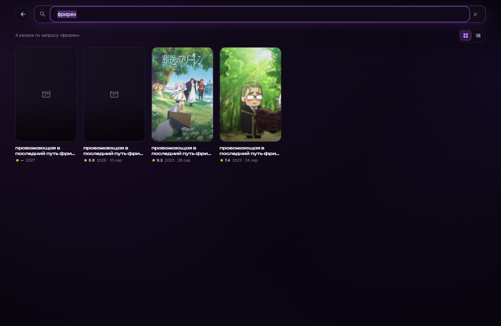
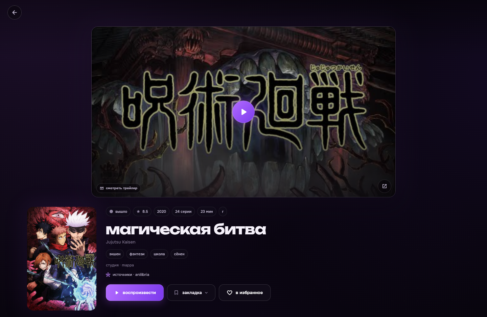
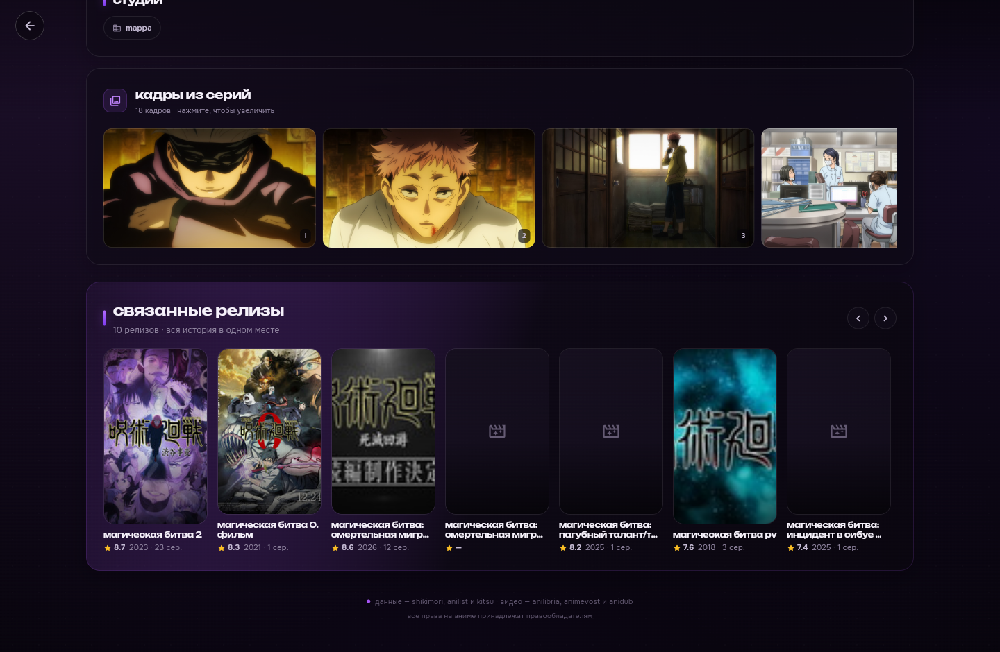
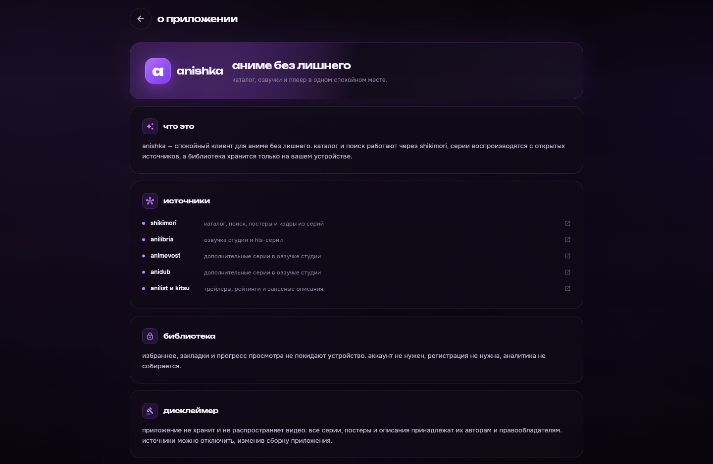

# anishka

**anishka** — a polished, cross-platform anime streaming app built with Flutter.  
No authorization, no in-app ads, black background with purple accent.  
Targets **Windows, Linux, Android, and Web**.

---

## Features

- **Catalog & search**: full **Shikimori** catalog (ongoing, search,
  franchise/related releases) with Russian metadata, enriched with
  **AniList** and **Kitsu** (English titles, scores, posters, banners,
  descriptions). Search opens as its own page with autofocus, debounce,
  suggestions and a smooth transition from the home search preview.
- **Home page**: compact header with search preview and an "о приложении"
  icon, plus convenient tabs (сейчас, избранное, смотрю, в планах,
  просмотренно) and a grid/list view toggle. No hero banner and no brand
  mark: the home screen is just the list.
- **Details page**: trailer-first card (click-to-play YouTube on web,
  external launch on native), poster and facts beside it, synopsis,
  genres/studios, episode stills from Shikimori, bookmarks (в планах,
  смотрю, просмотренно), favourite toggle, related releases in a distinct
  panel, and a "воспроизвести" bottom sheet with real source names.
- **Multi-source playback**: real source names in the picker —
  `anilibria`, `yani`, `kodik`, `hdrezka`, `animevost`, `sameband` and
  `anilibme`. Scraped sources resolve MP4/HLS lazily on play, Kodik
  episodes are grouped by season, and the picker switches the source
  automatically when a different voice is chosen.
- **Player**: full-screen, HLS via `media_kit`, custom controls,
  seek/volume/speed/quality, episode picker, skip opening/ending,
  progress save, keyboard shortcuts, immersive mobile mode,
  error/loading/completed states. Playback presets for hardware
  decoding (auto / compatibility / copy / CPU), network cache size and
  preferred quality are available both on the `/about` "видео" tab and
  from the speedometer button in the player; they apply without
  restarting the episode.
- **About page**: branding, data/video sources, playback presets,
  library privacy and disclaimer live on `/about` instead of the home
  screen. Bookmarks and favourites update instantly across the details
  page, cards and the library.
- **Offline-first caching**: API responses cached in memory + disk
  (`shared_preferences`), library state persists across restarts.
- **All UI lowercase**; **Unbounded** headings, **Onest** body.
- **Free playback**; no ads injected by the app.
  *(Legal note: AniLibria HLS URLs include `isWithVideoAds=1`; the app does
  not strip it. Use responsibly and respect the source.)*

---

## Screenshots

| Home | Search | Details |
|------|--------|---------|
|  |  |  |

| Stills & related | About | Player |
|------------------|-------|--------|
|  |  |  |

---

## Platform Status

| Platform | Status | Notes |
|----------|--------|-------|
| **Web**  | ✅ Works | HLS via bundled `hls.js`; poster images use HTML `` platform-view to bypass missing CORS. |
| **Linux** | ✅ Works | Requires system `libmpv.so.2`. Vendored `media_kit` 1.2.6 disables mpv Lua scripts to avoid a `console.lua` SIGSEGV on some distros; vendored `media_kit_video` 2.0.1 fixes the software-rendering fallback that caused constant stutter. |
| **Windows** | ⚠️ Source-compatible | Cannot be built on Linux; CI or a Windows machine needed. |
| **Android** | ✅ Builds | Release APK builds with the Android SDK/NDK; playback uses device codecs, with hardware-decoding presets available in settings. |

---

## Quick Start

### Prerequisites

- **Flutter 3.50.0 (stable)** at `~/.local/opt/flutter` (or any stable ≥ 3.24).
- **Linux**: `libmpv` (`pacman -S mpv` / `apt install libmpv2`).
- **Android**: Android SDK + NDK (for `media_kit` native libs).
- **Web**: any modern browser with H.264/AAC support (Firefox, Chromium, Safari).

```bash
# Clone & enter
git clone https://github.com/yourname/anishka.git
cd anishka

# Use the pinned Flutter (or your own)
export PATH="$HOME/.local/opt/flutter/bin:$PATH"

# Get deps
flutter pub get

# Generate fonts (once)
dart run google_fonts:generate_fonts

# Run
flutter run -d chrome        # web
flutter run -d linux         # linux
flutter run -d windows       # windows
flutter run -d android       # android
```

### Build Release

```bash
flutter build web --release        # → build/web/
flutter build linux --release      # → build/linux/x64/release/bundle/
flutter build windows --release    # → build/windows/runner/Release/
flutter build apk --release        # → build/app/outputs/flutter-apk/
flutter build appbundle --release  # → build/app/outputs/bundle/
```

---

## Architecture

```
lib/
├── core/
│   ├── api/           # Shikimori, AniList GraphQL, Kitsu REST (dio)
│   ├── models/        # AnimeRelease, ShikimoriAnime, AnimeSource, Voiceover
│   ├── repository/    # unified catalog + multi-source aggregation
│   ├── router/        # go_router configuration (/search, /about, /anime, /watch)
│   ├── sources/       # AniLibria, AnimeVost, AniDub, Kodik adapters
│   ├── storage/       # LibraryStore (favorites, statuses, progress)
│   ├── theme/         # AppColors, AppTheme (black + violet)
│   └── utils/         # format, errors, youtube, lc extension
├── features/
│   ├── home/          # HomeScreen, ongoing/library views, tabs
│   ├── search/        # standalone SearchScreen
│   ├── about/         # AboutScreen (branding, sources, disclaimer)
│   ├── details/       # DetailsScreen, trailer card, stills, playback_sheet
│   └── player/        # PlayerScreen, controls, video_surface (web fix)
├── ui/
│   └── widgets/       # AppImage, TrailerView, AnimeCard, view toggle, ...
└── main.dart          # Bootstrap, provider, router
```

### Key Decisions

- **Catalog**: Shikimori public API at `https://shikimori.io/api` (the
  `.io` host has working CORS for browsers; `shikimori.one` redirects and
  breaks web requests). Used for search, ongoing lists, metadata,
  franchise relations, trailers and episode screenshots.
- **Metadata enrichment**: AniList GraphQL (`https://graphql.anilist.co`)
  and Kitsu REST (`https://kitsu.io/api/edge`) fill in English titles,
  scores, posters/banners and descriptions when Shikimori metadata is
  thin. Both are optional: enrichment never throws and the page degrades
  gracefully.
- **Playback**: AniLibria v4 (`https://anilibria.top/api/v1`) resolved by
  Shikimori ID, with AnimeVost / AniDub / Kodik as fallback sources.
  AnimeVost and AniDub are scraped with DLE search + lazy stream
  resolution (AnimeVost MP4 mirrors via `frame5.php`, AniDub Sibnet
  embeds). A source search is capped at 8 s and details at 6 s so the
  details page never hangs.
- **Browser limits**: Shikimori, AniList, Kitsu and AniLibria are CORS-
  friendly, so the web build shows metadata plus AniLibria playback.
  AnimeVost/AniDub HTML endpoints are not CORS-enabled: those sources
  appear only in native builds and fail silently on web by design.
- **Trailer**: the details page leads with a trailer card. On web it shows
  the YouTube thumbnail first and loads a real iframe only after the user
  taps (interactive mode with sound); native builds open YouTube
  externally. The ambient muted mode remains available for background
  use.
- **Voiceovers**: AniLibria cast members are grouped into a single
  `anilibria` studio track with names as the subtitle. AnimeVost and
  AniDub expose their own source-level tracks, so the picker shows real
  source names rather than cast nicknames.
- **State**: `provider` + `ChangeNotifier`; `go_router` for navigation.
- **Fonts**: Bundled from Google Fonts variable fonts (Unbounded 400–800,
  Onest 400–800) via `google_fonts` generator.
- **Player**: `media_kit` + `media_kit_video` + `media_kit_libs_video`.
  Web HLS via bundled `hls.js` 1.4.10.
- **Images**: AniLibria thumbnails are 18×25 px; UI uses `posterUrl`/
  preview images with `memCacheWidth`. Web uses `Image.network` with
  `webHtmlElementStrategy: WebHtmlElementStrategy.prefer` to bypass
  missing CORS on image responses.
- **Linux crash fix**: `third_party/media_kit/` vendors `media_kit` 1.2.6
  with `dependency_overrides` in `pubspec.yaml`. Patch disables mpv
  built-in Lua scripts (`load-scripts=no`, `load-console=no`, …) before
  `mpv_initialize()` to avoid `console.lua` SIGSEGV in the `lua/console`
  thread on some systems (mpv 0.41 + libluajit 5.1). See
  `third_party/media_kit/PATCHES.md` for upgrade procedure.
- **Linux video rendering fix**: `third_party/media_kit_video/` vendors
  `media_kit_video` 2.0.1 with patches in `linux/video_output.cc`,
  `linux/texture_gl.cc`, and `lib/src/video/video_texture.dart`. Upstream
  2.0.1 calls `eglGetCurrentContext()` on the GTK platform thread, gets
  `EGL_NO_CONTEXT`, and silently falls back to software rendering
  (`S/W rendering`), which stutters at any decoder setting. The patch
  creates `mpv_render_context` lazily from the raster-thread `populate`
  callback with a context shared with Flutter's EGL context, renders into
  an FBO, and returns that shared texture to Flutter. A 1×1 bootstrap
  frame starts mpv decoding before real video dimensions are known. After
  playback starts, the log should contain `H/W rendering.` and
  `hwdec-current=vaapi` instead of `vaapi-copy`. See
  `third_party/media_kit_video/PATCHES.md`.

---

## Legal / Disclaimer

- **anishka** is a third-party client for **Shikimori** metadata and
  publicly available playback sources (AniLibria primary, plus AnimeVost,
  AniDub and Kodik fallbacks).
- It does **not host** any video content; all streams come from the
  respective sources (`anilibria.top` / `cache.libria.fun`, etc.).
- The app adds **no ads**, tracking, or analytics.
- AniLibria HLS URLs contain `isWithVideoAds=1`; the app does **not**
  strip this parameter. If you prefer ad-free playback, use an
  external blocker or the source’s official options.
- Respect each source’s Terms of Service and applicable copyright law.

---

## Contributing

1. Fork & create a feature branch.
2. `flutter analyze` must pass (excludes `third_party/**`).
3. `flutter test` must pass (27 unit/widget tests).
4. Keep UI strings lowercase; use `.lc` on API titles/descriptions.
5. PRs welcome: bug fixes, platform polish, new features.

---

## License

MIT — see `LICENSE`.

---

## Links

- AniLibria API docs: <https://anilibria.top/api/docs/v1>
- Flutter: <https://flutter.dev>
- media_kit: <https://github.com/media-kit/media-kit>